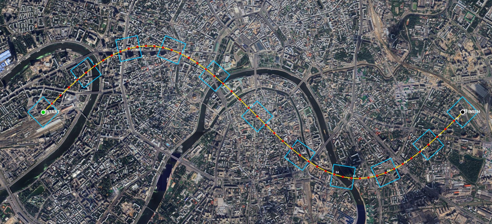

# UAV route reconstruction from satellite imagery (classic CV)

Given a large satellite map and 50 consecutive "photos" from a UAV (satellite crops taken at
another scale and rotation), the program finds where each photo was taken on the map and
draws the resulting route.



## How it works

Every photo is placed **directly on the big map** (not relative to the previous photo), so
errors do not pile up along the flight.

1. **SIFT** finds keypoints (corners, crossroads, roof edges) on the map and on the photo.
   Each keypoint gets a descriptor - 128 numbers describing its surroundings. SIFT works even
   if the photo is rotated or has another scale, which is exactly our case.
2. **Matching** - for each photo descriptor we look for the two most similar map descriptors
   (FLANN, a fast approximate search). The *ratio test* keeps a match only if the best
   candidate is clearly better than the second one (`0.75`), otherwise it is ambiguous.
3. **Homography + RANSAC** - `cv2.findHomography` finds a 3x3 matrix that converts photo
   coordinates to map coordinates. RANSAC ignores wrong matches and keeps the biggest
   consistent group; the photo is accepted if at least 15 matches agree (*inliers*).
4. **Route point** - the photo centre converted with this matrix is one point of the route;
   the four converted corners give the footprint of the photo (size and rotation are kept).
5. **Wrong places** - a photo can be matched to a *wrong* place of the map with hundreds of
   inliers (a repeated pattern, a broken photo), so the inlier count cannot catch it. But the
   drone cannot jump: every point is compared with the median of its 4+4 neighbours and is
   dropped if it is farther than 4 local steps (and at least one photo size, so a hovering
   drone is fine). Medians ignore a few bad neighbours, so several wrong photos in a row are
   caught too.
6. **Missing photos** - if a photo is not found or dropped, its point is placed on the straight
   line between the neighbouring found photos (drawn in orange).

## Results

* 50 / 50 photos found, 109-359 inliers per photo (mean ~260).
* The route is smooth from photo 0 (START) to photo 49 (FINISH).
* `results/verification.png` - sanity check: photo (left) vs. the map warped into the photo's
  view (right); buildings, bridges and rails coincide.

### Comparison of the versions (synthetic flights with known truth)

The task has no true coordinates, so all branches were run on 9 synthetic 50-photo flights cut
from the map at known places: clean, degraded (lighting/blur/noise/clouds/colour + tilt), all
degradations at once, broken photos, **wrong places in a row**, altitude 90-520 px,
**hovering drone**, sharp zigzag turns, every 2nd photo unusable. "Bad points" = route points
more than 22 px (10 % of a photo) from the truth.

| version | bad points (9 flights, 450 points) | where it fails | median error | time / flight |
|---------|-----------------------------------|----------------|--------------|---------------|
| `complex-version` (modular, first version) | 20 | wrong places in a row (5), hovering (14), 1* | 0.35 px | ~10 s |
| `simplify` (PR #2) | 11 | any wrong place (2 + 5), every-2nd-lost (4) | 0.35 px | ~10 s |
| `benchmark-and-pitch` (PR #1) | 20 | same as `complex-version` | 0.35 px | ~10 s |
| **`main` (= `simple-robust`, this)** | **1*** | - | 0.35 px | ~10 s |

\* the last photo of the "every 2nd unusable" flight is noise, so every version ends the route
at the previous photo (one step, 65 px) - nothing to fix there.

Accuracy and speed are the same everywhere (same SIFT + RANSAC core); the versions differ only
in how they treat bad photos. The map-features cache of the modular versions saves ~3 s per run
and the multi-scale fallback did not change any route, so this version keeps neither.

### Downscaling experiment (photo scale before SIFT)

| scale | photos found | mean inliers | min inliers | time (50 photos) |
|-------|--------------|--------------|-------------|------------------|
| 1.0   | 50/50        | 261          | 112         | 22 s             |
| 0.5   | 50/50        | 263          | 109         | 6 s              |
| 0.35  | 50/50        | 261          | 108         | 3 s              |
| 0.25  | 50/50        | 256          | 108         | 2 s              |

The quality is practically the same, but smaller photos are much faster, so `SCALE = 0.5`
(constant at the top of `main.py`).

## Usage

```bash
python -m venv .venv
.venv\Scripts\activate          # Linux/macOS: source .venv/bin/activate
pip install -r requirements.txt

python main.py --map data/global_map.png --frames data/crops --out results
python selftest.py --map data/global_map.png      # unit + end-to-end test with known truth
```

The task data goes into `data/` (it is not stored in the repository). Output in `results/`:
`route.png` (map with the route, numbered points, START/FINISH, footprint of every 5th photo)
and `trajectory.csv` (route points in map pixels). The run takes about 12 seconds.

## Files

| File | Purpose |
|------|---------|
| `main.py` | the whole solution (about 190 lines, every function is commented) |
| `selftest.py` | tests with known truth: `drop_jumps` cases + a synthetic flight with broken photos |
| `explore_single.py` | step-by-step prototype for a single photo |
| `pitch/` | pitch slides (EN and UA) |

## Other versions of the code (git branches)

`main` is the simple one-file solution plus the one step that measurably matters
(dropping wrong places). The other versions are kept in branches:

* `complex-version` - the first version, split into modules (`localizer.py`, `trajectory.py`,
  `visualize.py`) with a map-features cache, outlier rejection, smoothing and a route video.
* `benchmark-and-pitch` (pull request #1) - on top of that: accuracy benchmark on synthetic
  frames with known ground truth (`benchmark.py`), multi-scale fallback, per-frame CSV report,
  `--verify`. **The single-photo numbers in `pitch/`** ("0 wrong answers in 540 tests") come from
  its `benchmark.py`; the localisation core is the same in all versions.
* `simplify` (pull request #2, merged) - the one-file version without any check of wrong places.
* `simple-robust` (pull request #3, merged) - `simplify` plus the wrong-place check; this is
  what `main` contains now.

## Limitations

* Photo order is taken from the file numbers (`crop_0` ... `crop_49`).
* A photo that is not found or dropped is replaced by a point on the straight line between its
  neighbours (on a curve this can be a few px off); if the last photo is lost, the route ends at
  the previous one.
* If more than ~4 of 9 photos in a row show the same wrong place, they cannot be told apart from
  the real route.
* Works because photos and map are the same kind of imagery. Real UAV photos with another
  season or lighting would need a stronger matcher (SuperPoint + LightGlue, LoFTR).
* Coordinates are in map pixels; GPS would need the georeference of the map.
